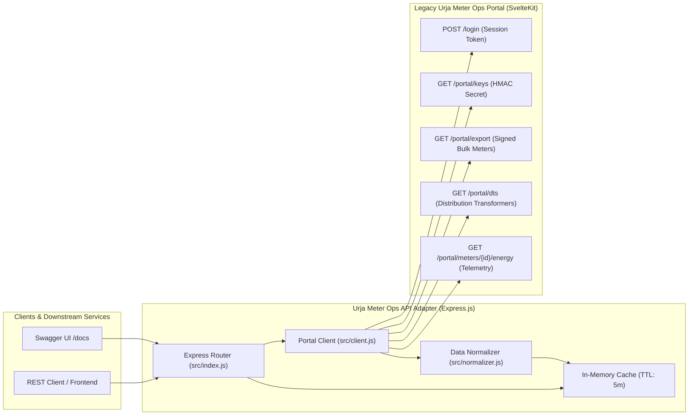

# Urja Meter Ops REST API Adapter

A high-performance, resilient, and fully documented REST API adapter written in Node.js/Express that reverse-engineers the legacy **Urja Meter Ops Portal** (`https://urja-ops.flockenergy.tech`). It automates authentication and session handling, bypasses slow HTML scraping via signed bulk internal APIs, repairs corrupted hierarchy data, and exposes clean, OpenAPI-compliant endpoints for downstream services.

---

## Key Documents

| Document | Description |
| :--- | :--- |
| **[PROTOCOL.md](./PROTOCOL.md)** | Reverse-engineered protocol documentation — how the legacy portal works under the hood, discovered endpoints, auth flow, HMAC signing, and data quirks. |
| **[openapi.json](./openapi.json)** | OpenAPI 3.0.3 specification for this API (also served live at `/openapi.json` and rendered at `/docs`). |
| **[REFLECTION.md](./REFLECTION.md)** | Answers to the five reflection questions (assumptions, difficulties, improvements, mistakes, self-critique). |

---

## Table of Contents
- [1. Architecture & Design](#1-architecture--design)
- [2. Getting Started](#2-getting-started)
  - [Prerequisites](#prerequisites)
  - [Installation](#installation)
  - [Environment Variables](#environment-variables)
  - [Running the Server](#running-the-server)
- [3. Interactive API Documentation (Swagger)](#3-interactive-api-documentation-swagger)
- [4. API Endpoints & Sample Requests](#4-api-endpoints--sample-requests)
  - [Health & Sync](#health--sync)
  - [Smart Meters](#smart-meters)
  - [Distribution Transformers](#distribution-transformers)
  - [Network Summary & Data Quality](#network-summary--data-quality)
- [5. Data Quality & Hierarchy Normalization](#5-data-quality--hierarchy-normalization)
- [6. Assumptions](#6-assumptions)
- [7. Design Decisions & Trade-offs](#7-design-decisions--trade-offs)
- [8. Intentional Omissions](#8-intentional-omissions)
- [9. What I'd Improve With More Time](#9-what-id-improve-with-more-time)
- [10. Reflection](#10-reflection)

---

## 1. Architecture & Design



### Key Modules:
* **`src/client.js`**: Handles SvelteKit session cookie management, automatic re-authentication upon session expiration, cryptographic request signing (`x-signature` using HMAC-SHA256), and upstream communication.
* **`src/normalizer.js`**: Repairs missing upstream hierarchy fields, resolves transformer naming conflicts (e.g. `DT-007`), standardizes date-time formats to ISO-8601 UTC, and coerces numeric strings into native types.
* **`src/index.js`**: Express.js server defining clean RESTful endpoints, query filtering, pagination, and Swagger UI integration.
* **`src/config.js`**: Centralized environment variable loader and validation.
* **`openapi.json`**: OpenAPI 3.0.3 specification documenting all schemas, parameters, and response structures.

---

## 2. Getting Started

### Prerequisites
* **Node.js** v18+ (tested on Node.js v20+)
* **npm** v9+

### Installation
Clone the repository and install dependencies:
```bash
git clone https://github.com/nxtwave_company_projects/flock-energy-api.git
cd flock-energy-api
npm install
```

### Environment Variables
Copy `.env.example` to `.env` and adjust the variables if needed:
```bash
cp .env.example .env
```

Default `.env` configuration:
```env
PORT=3000
URJA_BASE_URL=https://urja-ops.flockenergy.tech
URJA_USERNAME=operator@urja.local
URJA_PASSWORD=urja-ops-2026
CACHE_TTL_MS=300000
```

### Running the Server
```bash
# Start in production mode
npm start

# Start in development mode (with auto-reload via nodemon)
npm run dev
```

The server will initialize at `http://localhost:3000`.

---

## 3. Interactive API Documentation (Swagger)

Interactive Swagger UI documentation is available at:
* **Interactive Docs**: `http://localhost:3000/docs`
* **Raw OpenAPI Specification**: `http://localhost:3000/openapi.json`

---

## 4. API Endpoints & Sample Requests

### Health & Sync

#### `GET /health`
Returns service status, upstream connectivity, and cache freshness.
```bash
curl -X GET http://localhost:3000/health
```
```json
{
  "status": "ok",
  "upstream": "https://urja-ops.flockenergy.tech",
  "cache": {
    "syncedMeters": 403,
    "syncedTransformers": 40,
    "lastSyncedAt": "2026-10-24T12:00:00.000Z"
  }
}
```

#### `POST /api/v1/sync`
Forces a fresh synchronization of all meters and transformers from the upstream portal.
```bash
curl -X POST http://localhost:3000/api/v1/sync
```

---

### Smart Meters

#### `GET /api/v1/meters`
List, search, filter, and paginate smart meters.

**Available Query Parameters:**
* `q`: Search substring matching `meterId` or `serialNo`.
* `make`: Filter by manufacturer (`HPL`, `L&T`, `Genus`, `Allied`, `Secure`).
* `phaseType`: Filter by electrical phase (`single`, `three`).
* `installStatus`: Filter by status (`Installed`, `Faulty`, `Decommissioned`).
* `dtCode`: Filter by Distribution Transformer code (e.g. `DT-001`).
* `feederCode`: Filter by feeder code (e.g. `F-001`).
* `substationCode`: Filter by substation code (e.g. `SS-01`).
* `zoneCode`: Filter by zone code (e.g. `Z-01`).
* `page`: Page index (default: `1`).
* `pageSize`: Items per page (default: `20`, max: `500`).

**Sample Request:**
```bash
curl -X GET "http://localhost:3000/api/v1/meters?make=HPL&phaseType=single&page=1&pageSize=2"
```
**Sample Response:**
```json
{
  "total": 65,
  "page": 1,
  "pageSize": 2,
  "totalPages": 33,
  "data": [
    {
      "meterId": "J100000",
      "serialNo": "SE33962",
      "make": "HPL",
      "phaseType": "single",
      "installStatus": "Installed",
      "installType": "Whole Current",
      "build": "v2",
      "dtCode": "DT-001",
      "hierarchy": {
        "zone": { "code": "Z-01", "name": "Jaipur Zone 1" },
        "circle": { "code": "C-01", "name": "Circle 1" },
        "division": { "code": "D-01", "name": "Division 1" },
        "subdivision": { "code": "SD-01", "name": "Subdivision 1" },
        "substation": { "code": "SS-01", "name": "Substation 1" },
        "feeder": { "code": "F-001", "name": "Feeder 1" },
        "dt": { "code": "DT-001", "name": "Malviya Nagar DT 1" }
      },
      "geo": { "lat": 26.8521, "lng": 75.8234 }
    }
  ]
}
```

#### `GET /api/v1/meters/:meterId`
Fetch full metadata and geographical coordinates for a single meter. Include telemetry by appending `?includeEnergy=true`.
```bash
curl -X GET "http://localhost:3000/api/v1/meters/J100000?includeEnergy=true"
```

#### `GET /api/v1/meters/:meterId/energy`
Retrieve 30-minute interval energy consumption, voltage telemetry, and calculated statistics (`consumedKwh`, `voltageStats`). Supports `from` and `to` ISO timestamp filters.
```bash
curl -X GET "http://localhost:3000/api/v1/meters/J100000/energy"
```
**Sample Response:**
```json
{
  "meterId": "J100000",
  "summary": {
    "readingCount": 48,
    "startTimestamp": "2026-10-24T00:00:00Z",
    "endTimestamp": "2026-10-24T23:30:00Z",
    "startKwh": 120.45,
    "endKwh": 145.95,
    "consumedKwh": 25.5,
    "voltageStats": {
      "minVoltR": 218,
      "maxVoltR": 242,
      "avgVoltR": 231.8
    }
  },
  "data": [
    {
      "timestamp": "2026-10-24T00:00:00Z",
      "rawTimestamp": "24/10/2026 00:00",
      "kwh": 120.45,
      "kvah": 123.1,
      "voltR": 234
    }
  ]
}
```

---

### Distribution Transformers

#### `GET /api/v1/transformers`
List all 40 Distribution Transformers with aggregate meter counts by installation status.
```bash
curl -X GET "http://localhost:3000/api/v1/transformers?capacityKva=250"
```
**Sample Response:**
```json
{
  "total": 40,
  "page": 1,
  "pageSize": 40,
  "totalPages": 1,
  "data": [
    {
      "code": "DT-001",
      "name": "Malviya Nagar DT 1",
      "feederCode": "F-001",
      "capacityKva": 250,
      "meterCounts": {
        "total": 11,
        "installed": 9,
        "faulty": 1,
        "decommissioned": 1
      }
    }
  ]
}
```

#### `GET /api/v1/transformers/:dtCode`
Retrieve single transformer details along with the full array of smart meters connected to it.
```bash
curl -X GET "http://localhost:3000/api/v1/transformers/DT-001"
```

---

### Network Summary & Data Quality

#### `GET /api/v1/network/summary`
Returns fleet breakdown metrics (by status, make, phase) and a detailed log of all automated data-quality repairs performed.
```bash
curl -X GET "http://localhost:3000/api/v1/network/summary"
```

---

## 5. Data Quality & Hierarchy Normalization

The legacy portal upstream exhibits common industrial data defects that this adapter actively cleanses:

1. **Hierarchy Reconstruction**:
   * Upstream hierarchy nodes periodically contain a `name` without a `code` (e.g. `feeder: { name: "Feeder 001", code: null }`) or vice-versa.
   * `normalizer.js` applies pattern matching and zero-padded string synthesis (`pad2`, `pad3`) to repair missing identifiers.
2. **DT-007 Name Conflict Resolution**:
   * Upstream meter export labeled `DT-007` as `"Old Malviya Nagar Xfmr"`, while the canonical `/portal/dts` registry designated it as `"Sanganer DT 7"`.
   * The adapter uses `/portal/dts` as the canonical source of truth, assigns `"Sanganer DT 7"` as the primary name, preserves the conflicting name under `hierarchy.dt.legacyName`, and logs an anomaly note.
3. **Timestamp Standardization**:
   * Legacy format `DD/MM/YYYY HH:mm` is parsed into standard ISO-8601 UTC strings (`YYYY-MM-DDTHH:mm:00Z`).
4. **Type Coercion**:
   * Telemetry figures (`kwh`, `kvah`, `voltR`), capacities, and coordinates (`lat`, `lng`) are coerced from strings into numbers.

---

## 6. Assumptions

* The 403-meter dataset and 40 Distribution Transformers change infrequently (typical of utility asset registries), so an in-memory cache with a 5-minute TTL is sufficient.
* `/portal/dts` is the canonical source of truth for DT names, taking precedence over names embedded in the meter export's hierarchy objects.
* The portal is a SvelteKit application, and internal JSON endpoints (`/portal/*`) are stable and intended for programmatic use by the frontend.
* Meter energy telemetry is queried on-demand and doesn't need bulk pre-fetching at startup.
* The HMAC signing mechanism for `/portal/export` uses `[method, path, query, timestamp].join('\n')` based on reverse engineering of the client bundle.

---

## 7. Design Decisions & Trade-offs

| Decision | Trade-Off | Rationale |
| :--- | :--- | :--- |
| **Reverse-Engineered Bulk API vs. HTML Scraping** | Bypasses Cheerio HTML scraping across 21 pages in favor of `/portal/keys` + signed `/portal/export`. | Reduces synchronization time from ~15 seconds to <300ms, eliminates UI DOM fragility, and provides richer metadata. |
| **In-Memory Cache (5-min TTL)** | Stateful per process; does not persist across application restarts. | The 403-meter dataset is small (~500 KB in memory) and asset metadata changes infrequently. Eliminates database dependencies for zero-configuration setup. |
| **On-Demand Energy Telemetry Fetching** | Fetching energy telemetry requires an upstream call per meter on cache miss rather than bulk pre-fetching. | Meter telemetry is historical and queried on-demand. Bulk pre-fetching 403 meters would trigger 403 upstream requests on startup, risking rate-limiting. |
| **Single Canonical Truth for DT Names** | Subordinates meter export DT labels to the dedicated `/portal/dts` endpoint. | Asset registries (`/portal/dts`) are the standard utility source of truth for physical grid hardware. Conflicting legacy names are kept in `legacyName` for backwards compatibility. |
| **Manual Cookie Management** | Foregoes `tough-cookie` auto-jar in favor of manual `Set-Cookie` capture and `Cookie` header injection. | Provides explicit control over session lifecycle detection (302 redirect to `/login`) for automatic re-authentication logic. |

---

## 8. Intentional Omissions

These features were intentionally skipped in favor of a focused, high-quality core submission:

* **Unit Tests**: No automated test suite is included. With more time, I would add Jest-based tests for `normalizer.js` (hierarchy repair edge cases), `client.js` (HMAC signing logic), and integration tests with mocked upstream responses.
* **Rate Limiting / Backpressure**: No outbound rate limiting is applied to upstream portal requests. In production, a semaphore or token-bucket limiter would prevent overwhelming the legacy portal during high fan-out (e.g., many simultaneous `/energy` requests).
* **Persistent Cache Layer**: No database or file-system cache is used. In production with multiple processes or restarts, a persistent layer (SQLite, Redis) would avoid cold-start re-syncs.
* **CI/CD Pipeline**: No GitHub Actions or deployment configuration is included.
* **Authentication on the API itself**: The adapter exposes unauthenticated endpoints — it's a backend-to-backend service layer. In production, middleware for API keys or JWT tokens would be added.
* **Geo-spatial Queries**: The portal provides GPS coordinates (`lat`, `lng`) per meter. A "what's near this location?" query layer (using haversine distance or a spatial index) was considered but omitted.

---

## 9. What I'd Improve With More Time

* **Persistent SQLite cache** with background polling for meter energy telemetry, enabling analytical queries like "total kWh load per DT over the last 24 hours" without fan-out upstream calls.
* **Automated integration tests** with mocked upstream portal responses for regression-safe development.
* **Rate-limiting middleware** (both inbound on the API and outbound toward the portal).
* **A modern web dashboard** — a small React/Vue app rendering consumption charts (Chart.js), a Leaflet/Mapbox map of meter GPS positions, and an interactive hierarchy explorer.
* **WebSocket-based live telemetry** push, if the portal exposed any push channel for real-time meter readings.
* **Structured logging** (e.g., Pino/Winston) with correlation IDs for observability.

---

## 10. Reflection

See [REFLECTION.md](./REFLECTION.md) for detailed answers to:

1. What assumptions did you make?
2. Which part was the most difficult, and how did you get unstuck?
3. If you had another day, what would you improve?
4. What mistake did you make while solving this?
5. If you were reviewing your own submission, what would you criticise?
